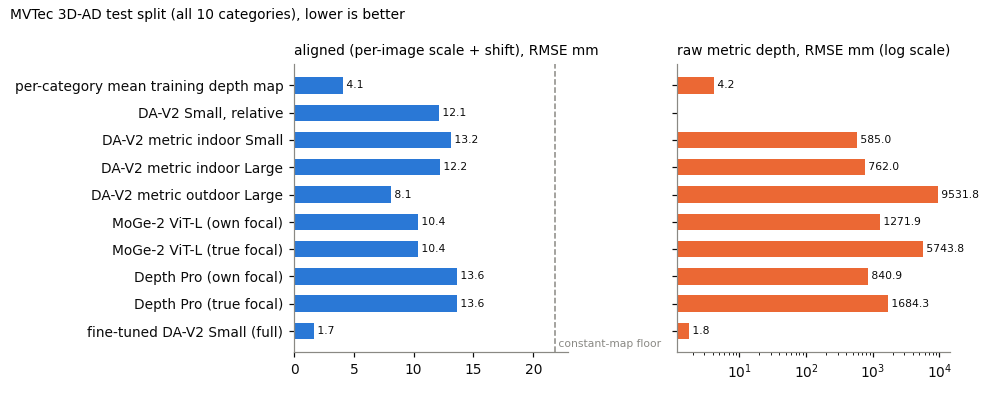
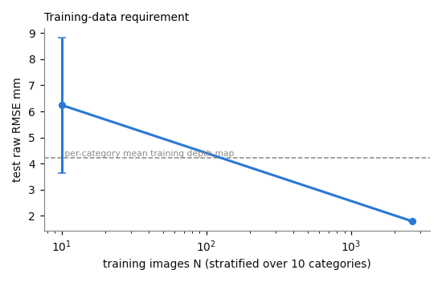
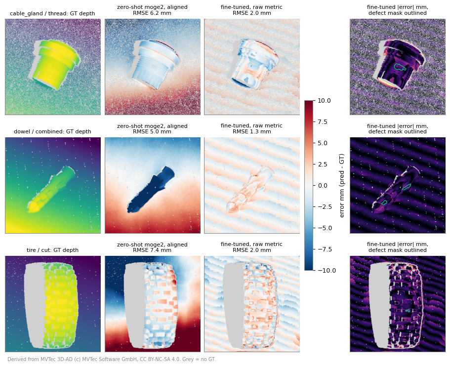

# industrial-depth-ft

Monocular depth estimation for a close-range industrial setting: a model-selection study (zero-shot comparison of
current monocular depth models) followed by fine-tuning of a commercially licensable model to metric depth, on real
structured-light ground truth from [MVTec 3D-AD](https://www.mvtec.com/research-teaching/datasets/mvtec-3d-ad)
(10 object categories, top-down views at roughly 0.5 to 0.7 m). The study answers the questions a thesis on
industrial monocular depth has to answer: which existing model is best out of the box, how well does it generalise,
how much labelled data does fine-tuning need, what accuracy is reachable in millimetres, and where does the error
sit. Every number below is measured on one NVIDIA L4 and generated from `results/*.json` by
`scripts/make_results.py`; nothing is estimated or typed by hand.

Companion to [depth3d-lab](../depth3d-lab) (zero-shot Depth Pro / Depth Anything V2 / MoGe-2 against LiDAR on
nuScenes-mini, outdoor, 1 to 80 m). This project adds close-range industrial data and fine-tuning.

## Headline (generated)

<!-- HEADLINE:BEGIN (generated by scripts/make_results.py) -->
- Fine-tuned DA-V2 Small (full, all training images, 1 seeds): test raw RMSE 1.79 mm, raw AbsRel 0.0024.
- Per-category mean training depth map (no image input): raw RMSE 4.21 mm.
- Best zero-shot metric model on raw depth: DA-V2 metric indoor Small, raw RMSE 585.0 mm.
- Best zero-shot model after per-image scale-and-shift alignment: DA-V2 metric outdoor Large, aligned RMSE 8.12 mm (constant-map floor: 21.79 mm).
<!-- HEADLINE:END -->

## Setup and protocol

- Data: MVTec 3D-AD, all 10 categories, downloaded per category and stream-extracted (`scripts/download_mvtec3d.sh`);
  per sample the RGB image, the Z channel of the organised XYZ point map (metres, zeros = no structured-light
  return) and the defect mask. Pinhole intrinsics are fitted per image from the point map (X/Z and Y/Z are linear in
  the pixel coordinates). Every sample is centre-cropped to a square and stored at 400 x 400 with a valid-aware area
  downsampling of depth (an output pixel is valid only if all covered input pixels are valid).
- Splits: MVTec train split = training pool, MVTec validation split = checkpoint selection, MVTec test split (good
  and defective objects) = test set for every table. Experiment D trains on 7 categories and holds out
  cable_gland, peach and rope (fixed in `idft/mvtec3d.py` before any training).
- Metrics on valid pixels, per image, then averaged over images: AbsRel, RMSE and MAE in mm, delta < 1.25 (d1) and
  the much tighter delta < 1.01 and < 1.005. "raw" is the metric output as is; "aligned" applies a per-image
  least-squares scale and shift against the ground truth (in depth for metric models, in inverse depth for the
  relative Depth Anything V2 Small). Because the whole scene spans only a few centimetres, d1 saturates at 1.0 for
  every aligned prediction and a constant map already reaches a small AbsRel; the constant-map row (aligned RMSE =
  per-image standard deviation of the ground truth) is the floor every aligned number must be read against.
- Fine-tuning: Depth Anything V2 Small (Apache-2.0), relative checkpoint switched to the transformers metric head
  (sigmoid x 1 m), last 1x1 conv re-initialised to output about 0.65 m. Loss: SILog on log depth (lambda 0.85, as in
  the Depth Anything V2 metric recipe) + 0.5 x 4-scale gradient matching on the log-depth residual, valid pixels
  only. AdamW, 3000 steps, batch 8, 518 x 518 input, bf16 autocast, 100 warm-up steps then cosine decay, flips and
  brightness / contrast jitter (no scale or crop augmentation, because the camera is fixed and a changed apparent
  focal length would make metric depth ambiguous). The checkpoint with the lowest validation RMSE is kept; the test
  split is never used for selection.

## Results

Full tables (per category, licences, quality analysis, export) are in [docs/RESULTS.md](docs/RESULTS.md).

### A. Zero-shot comparison (test split, all categories)

<!-- A_MAIN:BEGIN (generated by scripts/make_results.py) -->
| model | output | raw AbsRel | raw RMSE mm | raw d1 | aligned AbsRel | aligned RMSE mm | aligned MAE mm | aligned d<1.01 | aligned d1 | median ms/img (NVIDIA L4) |
|---|---|---|---|---|---|---|---|---|---|---|
| constant map (reference floor) | baseline | n/a | n/a | n/a | 0.0319 | 21.79 | 18.73 | 0.182 | 1.000 | n/a |
| per-category mean training depth map | baseline | 0.003 | 4.2 | 1.000 | 0.0033 | 4.09 | 1.90 | 0.928 | 1.000 | n/a |
| DA-V2 Small, relative | disparity | n/a | n/a | n/a | 0.0173 | 12.10 | 10.11 | 0.344 | 1.000 | 17.4 |
| DA-V2 metric indoor Small | metric | 0.996 | 585.0 | 0.047 | 0.0189 | 13.16 | 10.95 | 0.323 | 1.000 | 17.6 |
| DA-V2 metric indoor Large | metric | 1.272 | 762.0 | 0.023 | 0.0175 | 12.21 | 10.22 | 0.341 | 1.000 | 164.0 |
| DA-V2 metric outdoor Large | metric | 15.825 | 9531.8 | 0.000 | 0.0113 | 8.12 | 6.61 | 0.525 | 1.000 | 170.9 |
| MoGe-2 ViT-L (own focal) | metric | 2.227 | 1271.9 | 0.074 | 0.0146 | 10.35 | 8.50 | 0.432 | 1.000 | 185.5 |
| MoGe-2 ViT-L (true focal) | metric | 10.067 | 5743.8 | 0.000 | 0.0146 | 10.35 | 8.50 | 0.432 | 1.000 | 185.5 |
| Depth Pro (own focal) | metric | 1.460 | 840.9 | 0.106 | 0.0190 | 13.62 | 11.26 | 0.404 | 1.000 | 585.7 |
| Depth Pro (true focal) | metric | 2.881 | 1684.3 | 0.146 | 0.0190 | 13.62 | 11.26 | 0.404 | 1.000 | 585.7 |
<!-- A_MAIN:END -->

<!-- LICENCE:BEGIN (generated by scripts/make_results.py) -->
| model | licence of released weights | commercial use |
|---|---|---|
| DA-V2 Small, relative | Apache-2.0 (HF card and upstream README) | yes |
| DA-V2 metric indoor Small | Apache-2.0 per upstream README (Small); HF card has no tag | yes (verify) |
| DA-V2 metric indoor Large | CC-BY-NC-4.0 (upstream README: Base/Large/Giant); HF card has no tag | no |
| DA-V2 metric outdoor Large | CC-BY-NC-4.0 per upstream README; HF card says apache-2.0 (conflict) | unclear, treat as no |
| MoGe-2 ViT-L | MIT (HF model card Ruicheng/moge-2-vitl-normal) | yes |
| Depth Pro | Apple ML Research Model licence (apple-amlr), research use | no |
| this project's fine-tuned DA-V2 Small | weights derived from Apache-2.0 DA-V2 Small, but trained on MVTec 3D-AD (CC BY-NC-SA 4.0) - not usable commercially without MVTec's permission | no (data licence) |
<!-- LICENCE:END -->



### B. Fine-tuning configurations

<!-- B:BEGIN (generated by scripts/make_results.py) -->
| configuration | learning rate | trainable params | val RMSE mm (selection) | best step | test raw AbsRel | test raw RMSE mm | test raw MAE mm | test raw d<1.01 | test aligned RMSE mm | train min (NVIDIA L4) |
|---|---|---|---|---|---|---|---|---|---|---|
| (1) decoder + head only | dec 0.0002 | 2.73 M | 2.99 | 3000 / 3000 | 0.0043 | 3.17 | 2.47 | 0.926 | 2.73 | 5.8 |
| (2) full fine-tuning, encoder LR / 10 | dec 5e-05, enc 5e-06 | 24.79 M | 1.69 | 3000 / 3000 | 0.0024 | 1.79 | 1.39 | 0.991 | 1.68 | 9.5 |
| (3) LoRA r=16 on encoder attention + full decoder | dec 0.0001 | 3.32 M | 2.00 | 3000 / 3000 | 0.0029 | 2.11 | 1.68 | 0.982 | 1.79 | 9.2 |
<!-- B:END -->

<!-- BEST:BEGIN (generated by scripts/make_results.py) -->
Configuration selected by validation RMSE: **full**.
<!-- BEST:END -->

### C. Training-data requirement

<!-- C:BEGIN (generated by scripts/make_results.py) -->
| training images N | seeds | test raw RMSE mm | test raw AbsRel | test raw d<1.01 | test aligned RMSE mm | val RMSE mm |
|---|---|---|---|---|---|---|
| 10 | 2 | 6.24 +- 2.60 | 0.0092 +- 0.0041 | 0.814 +- 0.017 | 2.75 +- 0.33 | 5.06 +- 1.17 |
| 2656 | 1 | 1.79 | 0.0024 | 0.991 | 1.68 | 1.69 |
<!-- C:END -->



### D. Generalisation to held-out categories

<!-- D:BEGIN (generated by scripts/make_results.py) -->
| model | seen raw RMSE mm | seen aligned RMSE mm | held-out raw RMSE mm | held-out aligned RMSE mm |
|---|---|---|---|---|
| fine-tuned on all 10 categories (in-domain reference, seed 0) | 1.75 | 1.65 | 1.88 | 1.74 |
| zero-shot / reference: per-category mean training depth map | 4.37 | 4.25 | 3.81 | 3.66 |
| zero-shot / reference: DA-V2 Small, relative | n/a | 12.57 | n/a | 10.91 |
| zero-shot / reference: MoGe-2 ViT-L (own focal) | 1487.35 | 10.83 | 730.98 | 9.16 |
| zero-shot / reference: MoGe-2 ViT-L (true focal) | 6294.96 | 10.83 | 4360.28 | 9.16 |
| zero-shot / reference: Depth Pro (own focal) | 783.22 | 15.00 | 985.87 | 10.16 |
| zero-shot / reference: Depth Pro (true focal) | 1718.73 | 15.00 | 1597.80 | 10.16 |
| zero-shot / reference: DA-V2 metric indoor Large | 802.86 | 12.87 | 659.45 | 10.57 |
<!-- D:END -->

### Synthetic data (optional track)

<!-- S:BEGIN (generated by scripts/make_results.py) -->
| training data | seeds | test raw RMSE mm | test raw AbsRel | test aligned RMSE mm | val RMSE mm (real validation split) |
|---|---|---|---|---|---|
| synthetic only (1000 rendered images) | not run |  |  |  |  |
| real only, 50 images | not run |  |  |  |  |
| synthetic 1000 + real 50 | not run |  |  |  |  |
| real only, all images | 1 | 1.79 | 0.0024 | 1.68 | 1.69 |
| synthetic 1000 + real all | not run |  |  |  |  |

Synthetic set: 1000 training + 100 validation images rendered in 1.1 min (pyrender, EGL, NVIDIA L4), median depth range per image 0.596 - 0.620 m. All runs use the configuration selected in B and are selected on the real validation split.
<!-- S:END -->

### E. Where the error sits, and can it see a defect

<!-- E_DEFECT:BEGIN (generated by scripts/make_results.py) -->
not run
<!-- E_DEFECT:END -->



### F. Deployment check

<!-- F:BEGIN (generated by scripts/make_results.py) -->
not run
<!-- F:END -->

## Findings

FINDINGS_PLACEHOLDER

## Limitations

- Domain: MVTec 3D-AD shows food items, foam, rope, tyres, dowels and cable glands on a support surface, not aircraft
  or engine parts; large specular and dark metallic surfaces, which dominate in aerospace, are under-represented.
- Ground truth: structured light leaves holes on specular, dark and steep surfaces; those pixels are excluded, so
  the error on exactly the hardest surfaces is not measured. The ground truth itself has sensor noise and the
  aligned scores of the best models approach the regime where that noise matters.
- Size: about 2,650 training images from one sensor setup with a fixed working distance per category. Results say
  nothing about other distances, focal lengths or sensors, and the fine-tuned model has learnt this rig's scale.
- Seeds: three seeds where stated, one seed otherwise; differences smaller than the seed spread are not findings.
- The defect analysis uses the dataset's anomaly masks, which mark visible and geometric anomalies alike; a
  defect with no geometric signature cannot be seen in depth by any method.
- Licence: MVTec 3D-AD is CC BY-NC-SA 4.0; the fine-tuned weights are trained on it and are therefore not usable
  commercially without MVTec's permission, even though the base model is Apache-2.0.

## Next steps for an aerospace use case

1. Collect a few hundred images of the real parts with a structured-light or laser-line sensor in the target cell
   (same camera, same distance) and repeat Experiment C on them; the curve here is the planning basis.
2. Add a synthetic set rendered from the parts' CAD models with measured materials (anodised, machined and painted
   finishes) and the real camera intrinsics, and test synthetic pre-training plus small real fine-tuning.
3. Treat specular surfaces explicitly: polarisation or multi-exposure capture for ground truth, and a confidence
   output so the system can say where it does not know the depth.
4. If the task is defect detection, compare against a direct image-space anomaly model; depth from one image is
   only worth it where the defect has a geometric signature large enough for the error levels measured here.
5. Deployment: TensorRT fp16 engine from the static ONNX export, with the same parity check as in Experiment F.

## Reproduce

```bash
export SSL_CERT_FILE=/etc/pki/tls/certs/ca-bundle.crt REQUESTS_CA_BUNDLE=$SSL_CERT_FILE
uv venv -p 3.10 .venv
uv pip install --python .venv/bin/python torch==2.7.1 torchvision==0.22.1 --index-url https://download.pytorch.org/whl/cu126
uv pip install --python .venv/bin/python "numpy<2" opencv-python-headless matplotlib huggingface_hub \
    "transformers>=4.51" timm pytest ruff pillow tqdm scipy peft tifffile onnx onnxruntime-gpu
uv pip install --python .venv/bin/python "git+https://github.com/apple/ml-depth-pro.git"
uv pip install --python .venv/bin/python --no-deps "git+https://github.com/microsoft/MoGe.git" \
    "utils3d_moge @ git+https://github.com/EasternJournalist/utils3d-moge.git@62f09d58509485564e24d5d9f6aac9ee9ebc0c37"
# optional synthetic track
uv pip install --python .venv/bin/python --no-deps pyrender
uv pip install --python .venv/bin/python trimesh "pyglet<2" "PyOpenGL==3.1.7" networkx freetype-py imageio shapely mapbox-earcut
uv pip install --python .venv/bin/python -e .

bash scripts/download_mvtec3d.sh            # about 14 GB streamed, 2.5 GB kept as npz under data/proc
bash scripts/run_queue.sh                   # A (zero-shot), B, C, D on the GPU, logs in logs/
.venv/bin/python scripts/render_synth.py    # optional: 1000 + 100 synthetic images (EGL, headless)
bash scripts/run_post.sh                    # synthetic runs, E (quality analysis), F (ONNX export)
.venv/bin/python scripts/make_results.py    # writes every table in README.md, docs/RESULTS.md, STATUS.md
.venv/bin/python scripts/make_figures.py <test keys>   # docs/figures
.venv/bin/ruff check . && .venv/bin/pytest
```

Model weights (Depth Pro, Depth Anything V2 Small / metric indoor Small and Large / metric outdoor Large, MoGe-2)
are pulled into `~/.cache/huggingface` on first use; none are committed.

## Licences

- Code: MIT.
- Data: MVTec 3D-AD (c) MVTec Software GmbH, CC BY-NC-SA 4.0, research and non-commercial use; see Bergmann et al.,
  "The MVTec 3D-AD Dataset for Unsupervised 3D Anomaly Detection and Localization", VISAPP 2022. No dataset image is
  committed. `docs/figures/error_maps.png` shows depth and error maps derived from the dataset's ground truth (no RGB
  images) and is shared under CC BY-NC-SA 4.0 with this attribution; the other figures are plots of own metrics.
- Model weights: see the licence table above; Depth Pro and the Depth Anything V2 Large models are not licensed for
  commercial use, which is one reason the fine-tuning study uses Depth Anything V2 Small.
